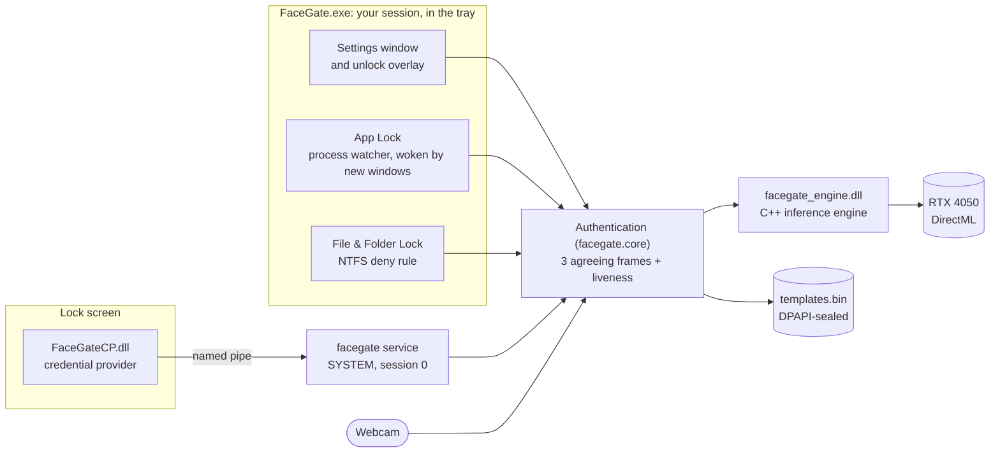
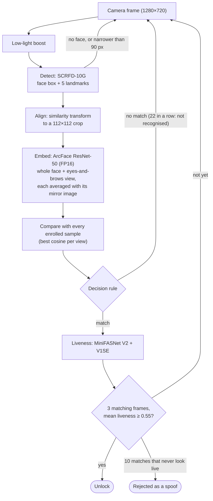
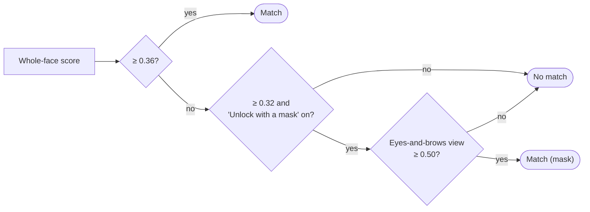
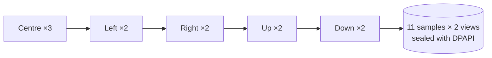
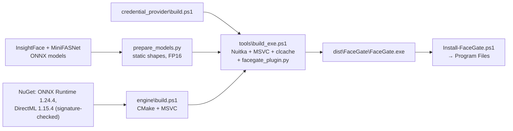
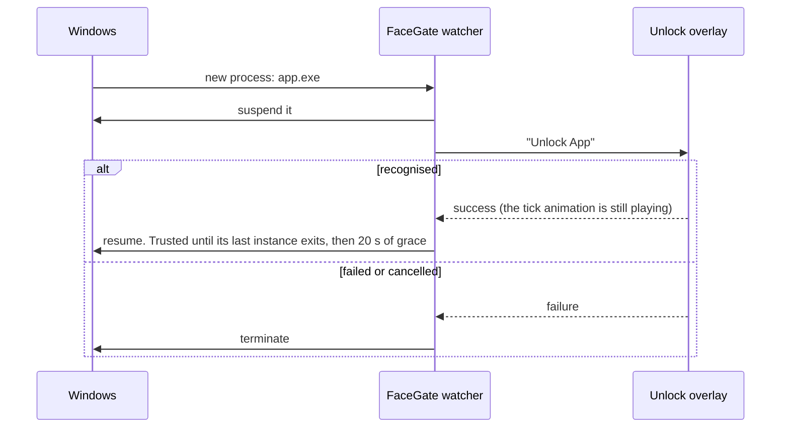
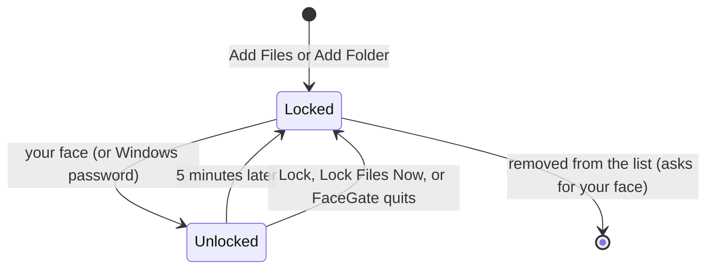
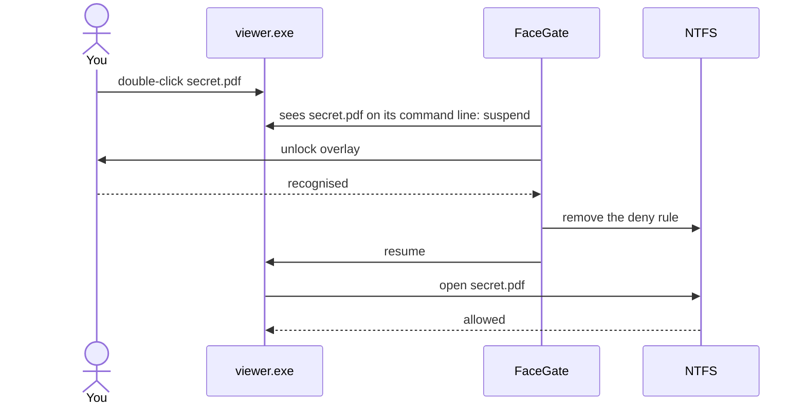
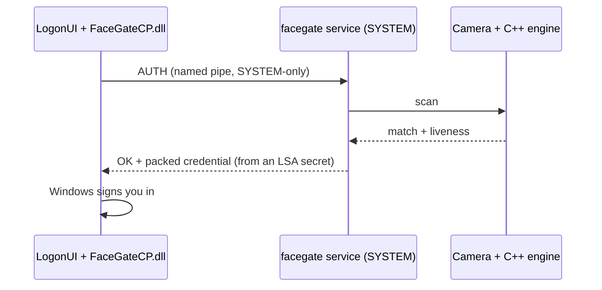

# FaceGate

Face unlock for Windows. Lock apps, files and folders behind your face, and (experimentally) unlock the PC from the lock screen. Recognition runs on the GPU in a C++ engine using deep networks, not landmark geometry, and ships as one Windows `.exe`.

- **App Lock**: pick any `.exe`. It is frozen the instant it starts and released only after you are recognised.
- **File & Folder Lock**: lock documents, photos or whole folders. Windows itself refuses every program, Explorer included, until your face unlocks them.
- **Windows unlock**: a credential provider adds FaceGate as a sign-in option on the lock screen.
- **Works with a cap, glasses, a mask, headphones or earbuds**: measured below, not just claimed.
- **Starts with Windows, then sleeps**: it waits in the tray with the camera off and the models unloaded, using about 0.3% of one CPU core, until a protected app or file is opened.
- **Anti-spoofing**: two networks reject photos and screens.
- **Animated overlay in your colours**: seven palettes, some of them flowing gradients, or any colour you pick. Brackets shimmer while scanning, close into a ring with a tick on success, and shake on failure.
- **Fast**: about 10 ms of compute per camera frame, including liveness, on the discrete GPU.
- **Private**: only 512-number embeddings are stored, sealed with Windows DPAPI. No images are kept, and no network calls are made after setup.

## Contents

[Read this first](#read-this-first-what-a-webcam-can-and-cannot-do) · [How it works](#how-it-works) · [Accuracy](#measured-accuracy) · [Speed](#speed) · [Get it](#get-it) · [Use](#use) · [App Lock](#app-lock) · [File & Folder Lock](#file--folder-lock) · [Windows unlock](#windows-unlock-experimental) · [Security notes](#security-notes) · [Troubleshooting](#troubleshooting) · [How FaceGate can improve](#how-facegate-can-improve) · [Development](#development) · [Licences](#models-and-licences)

## Read this first: what a webcam can and cannot do

Apple's Face ID projects 30,000 infrared dots and reads a depth map. This laptop (Acer Predator Helios Neo 16) has one ordinary RGB webcam and no infrared or depth sensor, so **no software can give it Face ID's resistance to spoofing**.

| | Face ID | FaceGate |
|---|---|---|
| Telling two people apart | about 1 in 1,000,000 (Apple's figure) | about 1 in 1,150,000 on the LFW benchmark |
| Rejecting a photo or video | depth sensing | a learned classifier on a 2-D image; good against casual attempts, not against a determined attacker |
| Works in the dark | yes (infrared) | no; needs some light on your face |

Treat it as a convenience lock that keeps family, colleagues and passers-by out. Do not rely on it against someone prepared to build a spoof of your face. Your Windows password or PIN always remains available.

## How it works



Everything that is compute (pixels in, numbers out) lives in the C++ engine, behind a C interface of a few functions. Everything that is policy (when to unlock, how many frames, lockout, which app or file) is Python. The app and the lock-screen service each run the same authentication code in their own process. The design decisions and their evidence are in [docs/architecture.md](docs/architecture.md).

### One scan, frame by frame



A scan gives up after 8 seconds. After five failed scans Face ID pauses for five minutes and only the Windows password is accepted.

### The decision rule (masks)

A recogniser embeds whatever is in the crop, mask included. So every sample, enrolled and live, is also embedded with the lower face painted out. That view compares only eyes, brows and forehead, and it never decides on its own.



The thresholds come from calibration, not guesswork (see [Measured accuracy](#measured-accuracy)). A matching "cap" view was built and then removed: the plain embedding already handles caps (99.2% against 99.6% uncovered), and the extra view only added false accepts.

### Enrollment



A sample is taken only when the face is at least 110 px wide, the head is turned the way the prompt asks, the crop is sharp, and the liveness check passes. **Adaptive learning** later adds up to 12 samples from confident live matches (score at least 0.15 above the threshold, liveness at least 0.80), so the gallery follows a new beard or glasses.

| Stage | Model | Purpose |
|---|---|---|
| Detect | SCRFD-10G (FP16, 384×640) | Face box and five landmarks |
| Align | similarity transform | Canonical 112×112 crop |
| Embed | ArcFace ResNet-50, WebFace600K (FP16, batch 4) | 512-d identity vector, averaged with its mirror image |
| Liveness | MiniFASNetV2 + V1SE | Probability that the face is live rather than a print or screen |

## Measured accuracy

`tools/eval_lfw.py` runs the real pipeline (the C++ engine, FP16, on the GPU) over 7,105 photos of 3,180 people from [LFW](http://vis-www.cs.umass.edu/lfw/). It compares every photo with every other: 17,118 same-person and 50,456,802 different-person comparisons. Each photo is also tested wearing four synthetic coverings: a mask, a cap, over-ear headphones and earbuds. The thresholds are not hand-picked: the tool searches for the best setting at a stated false-accept budget, here 1 in 1,000,000.

| Setting | Clear face | Mask | Cap | Headphones | Earbuds | Stranger accepted |
|---|---|---|---|---|---|---|
| Default (mask unlock on) | 99.58% | 90.12% | 99.19% | 99.52% | 99.58% | 1 in ~1,150,000 (clear), 1 in ~1,800,000 (masked) |
| Mask unlock off | 99.58% | 88.53% | 99.19% | 99.52% | 99.58% | 1 in ~1,150,000 |

**Headphones and earbuds need no retraining.**
- **What was tested:** over-ear cups and band (a third with a boom mic reaching to the mouth), and earbuds of three kinds: with a stem, round true-wireless, and wired.
- **The full pipeline sees them:** they are painted onto the photo through the face's landmarks, and the face is then detected again from scratch. It was found again in all 7,105 photos both times.
- **They cost at most 0.06 points**, because they sit at the very edge of the crop the network reads.
- **If yours still give you trouble,** use **Add Alternate Appearance** while wearing them. That is the per-person "training", and adaptive learning keeps it current.

Some caveats:

- **One reference photo:** the "accepted" figures compare against one photo, taken years apart and in a different place. FaceGate enrolls eleven samples across head poses, on the camera you unlock with, so real acceptance should be higher. That has not been measured.
- **Mislabelled pairs:** LFW contains mislabelled people. 68 "different-person" pairs score above 0.50, which genuine strangers essentially never do, so they are left out of the stranger column. Counting them, the stranger rate is 1 in ~450,000.
- **Bigger galleries:** a gallery of several samples gives a stranger several chances to match, so the per-attempt false-accept rate is higher than the per-comparison figure, by up to roughly the gallery size.
- **Synthetic coverings:** the masks, caps, headphones and earbuds are painted shapes. Real ones vary more.
- **Anti-spoofing is unmeasured:** no spoof dataset was used. On this laptop a live face scored 0.87–0.95 against a 0.55 threshold.
- **No accuracy cost from the C++ engine or FP16:** the Python FP32 reference measured 99.26% / 92.71% / 98.59% at the previous thresholds, and the C++ pipeline 99.28% / 92.77% / 98.50%.

## Speed

Measured per camera frame at 1280×720 on this laptop (RTX 4050, DirectML) with `tools/bench_engine.py`, each engine in its own process:

| Stage | Python engine | C++ engine |
|---|---|---|
| Detect (SCRFD) | 15.8 ms | 4.0 ms |
| Embed (full + mask view, with mirror images) | 9.7 ms | 3.6 ms |
| Liveness (two networks) | 33.4 ms | 1.4 ms |
| **One authentication frame** (with liveness) | **59.8 ms** | **9.8 ms** |

The camera delivers a frame every 33 ms, so the engine keeps up several times over. The remaining delay is the camera itself: about 0.75 s for the first frame, which no software can shorten. Expect roughly one second from trigger to unlock.

What the research found (details in [docs/architecture.md](docs/architecture.md)):

- **GPU choice:** DirectML lands on the RTX 4050 here, not the Intel iGPU (which is 10× slower). The engine now requests the fast GPU explicitly and reports which one it got.
- **Liveness was the biggest cost:** on the CPU with default threading it took 37 ms; on the GPU it takes about 1.4 ms.
- **FP16 recognizer:** 10.7 → 4.0 ms, with embeddings at cosine ≥ 0.99995 of FP32. A 384×640 detector input (the shape of a 16:9 frame) halves detection time.
- **Idle threads:** ONNX Runtime's idle threads busy-wait by default and slow everything else down on a 16-core hybrid CPU, so the engine turns that off.
- **ResNet-100 rejected:** a bigger recognizer was tested. It was worse at the 1-in-a-million operating point and needs twice the compute.

### Waiting in the background

FaceGate spends nearly all its time waiting, so waiting has been made almost free. The table below was measured in the tray with one app protected and one file locked:

| In the tray, nothing happening | Before | Now |
|---|---|---|
| CPU | 3.7% of one core | 0.3% of one core |
| Memory in use (working set) | 247 MB | 4 MB |
| Memory committed (private) | 1,517 MB | 42 MB |
| Threads | 53 | 7 |
| GPU memory | 235 MB | 0 MB |

How it got there:

- **Windows wakes it instead of polling:** the watcher used to list every process 33 times a second. Now Windows reports each new window (a WinEvent hook), and the watcher sees the app 13–23 ms after it starts, before its window appears.
  - A once-a-second check remains for programs that never open a window. That check is the remaining 0.3%.
  - With nothing protected or locked, it does not look at processes at all.
- **Models load on demand:** the engine loads when a scan starts or the settings window opens, while the camera is starting. It unloads after 10 idle minutes (`engine_idle_minutes` in `settings.json`; 0 keeps it loaded).
  - Its four networks are now created and warmed up in parallel, so loading takes 0.7–1.0 s instead of 1.1–1.5 s.
- **numpy is held to one thread:** its math library (OpenBLAS) started a thread per core and reserved about 750 MB at import. FaceGate's matrix work is a few hundred dot products.

| From the trigger to the first checked frame | |
|---|---|
| Models loaded | 0.8–0.9 s |
| Models unloaded (first scan after 10 idle minutes) | 1.3–1.5 s |

**Released the moment you are recognised.** A protected app is resumed as soon as the match is confirmed, while the tick animation still plays, not after the overlay fades out. That is about 1.5 s sooner than before, more than the first scan after an idle unload costs.

## Get it

### Build the exe

Requires Windows 10/11, Python 3.12, Visual Studio 2022 Build Tools (C++) and CMake.

```powershell
git clone https://github.com/DeveshR011/facegate.git
cd facegate
py -3.12 -m venv .venv
.venv\Scripts\pip install -r requirements-build.txt
```

```powershell
engine\build.ps1                                   # C++ engine + signed ONNX Runtime / DirectML runtime
.venv\Scripts\python tools\prepare_models.py       # downloads the models, writes static-shape FP16 versions
credential_provider\build.ps1                      # lock-screen component
tools\build_exe.ps1                                # Nuitka: dist\FaceGate\FaceGate.exe
```



How the build stays fast and lean:

- **Compiler cache:** with MSVC, Nuitka caches every compiled C file using its bundled **clcache** (ccache's MSVC counterpart). Rebuilds recompile only what changed, and the script prints the cache hit rate at the end. The full log is kept in `dist\nuitka-build.log`.
- **No link-time optimisation:** with it, the linker re-generated code for every file on every build, so a fully cached rebuild still took over four minutes. Inference runs in the C++ engine, so the compiled Python loses nothing that matters.
- **`packaging\nuitka\facegate_plugin.py`**, a Nuitka user plugin, does three things:
  - it bundles the engine, its runtime, the models and the lock-screen DLL under `native\`, and stops the build early if any of them is missing;
  - it keeps out modules Windows never imports (psutil's Linux, macOS and BSD backends);
  - it ships pywin32's large constant tables as bytecode instead of 14 MB of generated C.
- **Trimmed runtime files:** OpenCV's 29 MB ffmpeg plugin (video files only; webcams use the DirectShow and Media Foundation backends built into OpenCV) and the unused Qt plugins are left out. `FaceGate.exe selftest` lists the camera backends that remain.

Measured on this laptop (22 compile jobs):

| | With link-time optimisation | Now |
|---|---|---|
| First build (empty cache) | 4.5 min | 3.9 min |
| Rebuild, nothing changed (all 204 C files from the cache) | 4.3 min | 1.5 min |
| Folder build size | 352 MB before the trims | 318 MB |

About a minute of every build is Nuitka's own analysis of the Python code, which is not cached.

`tools\build_exe.ps1 -OneFile` produces a single `dist\FaceGate-portable.exe` instead.

| | Folder build `dist\FaceGate\` | Single file `FaceGate-portable.exe` |
|---|---|---|
| Start-up | fastest | unpacks once into a per-user cache, then fast |
| App Lock, File & Folder Lock, enrollment, themes | yes | yes |
| Elevated features (lock-screen unlock, start with Windows, locking admin apps) | yes, after `Install-FaceGate.ps1` | **no** (see [Security notes](#security-notes)) |

`Install-FaceGate.ps1` (in the folder) does four things:
- copies the build to Program Files;
- adds a Start Menu shortcut;
- sets FaceGate to **start with Windows**, for the account that ran the installer, even if you approve the UAC prompt with a different administrator account;
- starts it in the tray straight away.

Run it again to update. It stops FaceGate (and the lock-screen service, if that is on), replaces the files, and starts both again.

```powershell
.\Install-FaceGate.ps1                 # install or update, start with Windows
.\Install-FaceGate.ps1 -NoAutostart    # install only; start it from the Start Menu yourself
.\Install-FaceGate.ps1 -Uninstall      # remove it (add -RemoveData to delete your enrolled face too)
```

### Or run from source

```powershell
.venv\Scripts\pythonw -m facegate
```

The C++ engine is used automatically once it is built. Otherwise the Python engine runs instead; it downloads about 290 MB of models on first run, checked against pinned SHA-256 values.

### Check an installation

`FaceGate.exe selftest --image face.jpg --output report.json` loads the engine and runs it once, without the camera. The report includes:
- which GPU it ran on;
- the liveness score of the test image;
- whether every bundled dependency imports;
- the camera backends available.

## Use

1. **Set Up Face ID**: look at the camera and follow the prompts to turn your head.
2. **Add Alternate Appearance**: repeat the setup while wearing a cap, glasses or a mask, if you often do. This helps more than any setting.
3. **Add App…** under App Lock: choose an `.exe`, or pick one that's running, and leave its switch on.
4. **Add Files… / Add Folder…** under Files & Folders: anything except programs.
5. **Appearance**: pick the animation colours; **Preview** plays scanning, success and failure.

Closing the window keeps FaceGate guarding from the system tray. With **Start with Windows** on (the installer turns it on), you never need to open the window again. The tray menu also has **Lock Files Now**.

| Setting | Effect |
|---|---|
| Unlock with a mask | Accepts a near miss when the eyes-and-brows view independently agrees. |
| Require a live face | Anti-spoofing check. Turning it off needs your face or password. |
| Adaptive learning | Adds confident live matches to the gallery, so it follows a beard or new glasses. |
| Lock protected apps | Master switch for App Lock. |
| Start with Windows | A scheduled task that starts FaceGate elevated at sign-in, without a UAC prompt. The installer turns it on. |
| Appearance | Seven palettes (Classic, Ocean, Aurora, Sunset, Neon, Rainbow, Mono) or a custom colour. |
| `relock_minutes` in `settings.json` | How long an unlocked file or folder stays open (default 5). |
| `engine_idle_minutes` in `settings.json` | Unload the models after this many idle minutes, freeing about 600 MB of memory and 235 MB of GPU memory (default 10; 0 keeps them loaded). |

These actions require your face or password first:
- removing a protected app or a locked item;
- switching off an app's lock;
- disabling liveness;
- quitting while apps are protected. Quitting always locks your files again.

## App Lock



Windows does not let a normal process freeze one that runs as administrator. Click **Restart as Administrator**, or enable **Start with Windows**, so FaceGate can lock elevated apps too. Both need the installed build (see [Security notes](#security-notes)).

## File & Folder Lock

Locking adds one NTFS permission rule to the item: **deny** read, list, open and write to *INTERACTIVE*, the group every program a signed-in person starts belongs to. A folder's rule is inherited by everything inside it. Windows enforces the rule for every program, so a locked item is refused by Explorer, Word, a photo viewer, `cmd /c type` or a script alike, not only by programs FaceGate happens to notice.

The contents are never rewritten: locking and unlocking only add and remove that rule, so nothing can be corrupted. Locking needs no administrator rights, because you own your files.



There are three ways to unlock an item:

1. **Just open it.** When a program starts with a locked file on its command line, which is what a double-click does for most desktop apps, FaceGate freezes it, shows the overlay, unlocks the item, and lets the program continue.
2. **Right-click → Unlock with FaceGate.** On Windows 11 this sits under *Show more options*. It works for anything, including folders and single-instance apps that are already running, such as Word.
3. **Open** in FaceGate's window.



If the scan fails, the program is still resumed, and Windows refuses it the file on its own.

What a lock does and does not do:

| | Locked folder | Locked file |
|---|---|---|
| Open, read, list, copy, change | refused | refused |
| Rename or move (on the same drive) | allowed, and it stays locked | allowed, and it stays locked |
| Delete | refused while it has contents (they cannot be listed) | **allowed**: that permission comes from the folder it is in, so lock the folder to prevent it |

- **What can't be locked:**
  - Windows, Program Files, ProgramData, AppData and Temp;
  - FaceGate's own folders;
  - any folder that contains one of those;
  - whole drives and network locations;
  - Desktop, Documents, Downloads, Pictures, Music, Videos and OneDrive themselves (lock a folder inside them instead);
  - programs (`.exe`), which belong in App Lock.
- **Unsupported drives:** USB sticks formatted FAT32 or exFAT have no permissions to set. FaceGate shows the item as "Not locked" with the reason.
- **OneDrive:** it cannot sync an item while it is locked.
- **Thumbnails:** for a single locked image, a thumbnail Windows cached earlier may still show. Lock the folder instead.
- **Services keep working:** services such as backup run as SYSTEM, not INTERACTIVE, so they still read locked items.

## Windows unlock (experimental)

> **Not yet tested on a real lock screen.** The DLL compiles warning-free and passes a harness that plays LogonUI's role against a fake service (seven scenarios, including the packed credential and cancellation). The real LogonUI has never loaded it, and the SYSTEM service has not been run in session 0. Try it only when you can afford to troubleshoot.



Windows will not unlock without a real credential, so you type your account password once. It is stored as an LSA private secret (readable only by SYSTEM and administrators), never in a file, and handed to the lock screen only after a match.

To set it up:
1. Install the folder build (`Install-FaceGate.ps1`) and start it from the Start Menu.
2. Click **Restart as Administrator**.
3. Switch on **Unlock Windows with your face** and enter your password.
4. Lock with `Win+L` to try it.

Safeguards:

- **After a restart** you must sign in with your password once before face unlock is offered.
- **One automatic scan** per lock-screen appearance; more only when you click **Try again**.
- **Changed password:** if Windows rejects the stored password, face unlock pauses itself rather than retrying.
- **Pipe security:** the pipe admits SYSTEM only, and the provider connects at identification level, so a fake pipe cannot impersonate LogonUI.

## Security notes

- **Elevated code must live in an administrator-only folder.** The compiled app refuses to register elevated tasks or restart itself elevated unless it both runs from and unpacks to Program Files. That is why the single-file build cannot do elevated features (it unpacks into a per-user cache that any of your programs can write to). It is also why elevated processes ignore the `FACEGATE_HOME` and `FACEGATE_NATIVE_DIR` overrides.
- **Running from source is different.** The lock-screen service and elevated autostart then run your source tree and its `.venv`, so anyone who can edit those files can run code as SYSTEM. On a single-user PC where you are the administrator that grants nothing new; on a shared PC, use the installed folder build.
- **App Lock is a deterrent, not a sandbox.** It matches executables by path, so a copy of the `.exe` elsewhere is not locked, and an administrator can end FaceGate from Task Manager.
- **File & Folder Lock stops people, not malware.** The rule is enforced by Windows for every program. However, anything running as you or as an administrator can remove it, exactly as FaceGate does, and it is not enforced when the disk is read from another operating system. For protection at rest, use BitLocker.
- **Templates use machine-scope DPAPI** so that the SYSTEM service can read what you enrolled. Any local account can decrypt them, but the file is useless on another PC. Enabling Windows unlock restricts the data folder to SYSTEM, administrators and you.
- **Templates are sensitive.** Embeddings are not images, but research has shown that approximate faces can be reconstructed from them. Treat `templates.bin` accordingly.
- **Signed runtime:** ONNX Runtime and DirectML are downloaded from NuGet, and the build refuses to continue unless both DLLs carry a valid Microsoft signature.

## Troubleshooting

| Problem | Fix |
|---|---|
| A file or folder stays locked (FaceGate uninstalled, the item was renamed, or something went wrong) | `icacls "D:\path\to\item" /remove:d *S-1-5-4`. This removes only FaceGate's rule and needs no administrator rights for your own files. |
| A locked item shows **Not found** | It was renamed or moved, and the lock went with it. Rename it back, or unlock it with the command above and add it again. |
| Face unlock misbehaves at the lock screen | Choose **Sign-in options** and use your password or PIN. Windows does not load third-party credential providers in Safe Mode, so you can always boot there and switch the feature off, or delete `HKLM\SOFTWARE\Microsoft\Windows\CurrentVersion\Authentication\Credential Providers\{7B3C9F2E-5A41-4D8B-9E6C-2F1A8D4B6C73}`. |
| "Face ID is paused" | Five failed scans in a row. Use your Windows password, or wait five minutes. |
| FaceGate does not start when you sign in | Run `Install-FaceGate.ps1` again, or switch **Start with Windows** off and on. The task is *FaceGate\App* in Task Scheduler. The single-file build cannot start with Windows (see [Security notes](#security-notes)). |
| Does the exe work on this PC? | `FaceGate.exe selftest --output report.json` |
| Logs | `C:\ProgramData\FaceGate\logs` (`app-<user>.log`, `service.log`) |

## How FaceGate can improve

The current limits come from the hardware, from what has not been measured yet, and from what Windows lets a user-mode app do. Roughly in order of value:

| Area | Improvement | Why it matters |
|---|---|---|
| Anti-spoofing | Support Windows Hello IR cameras (infrared plus depth cues) | The biggest gap to Face ID. A 2-D RGB image cannot prove a face is three-dimensional. |
| Anti-spoofing | Benchmark liveness on OULU-NPU, SiW or CelebA-Spoof and calibrate its threshold the way the match threshold was | Today's 0.55 is a sensible default, not a measured operating point. |
| Anti-spoofing | Temporal liveness (blink and micro-motion across the frames already captured), or an optional "turn your head" challenge | Defeats printed photos and still screens cheaply. |
| Accuracy | Measure false rejects on your own camera, with opt-in local score logs | LFW is a proxy; your lighting and camera are what count. |
| Accuracy | Fine-tune the mask view on real masked faces, not painted polygons | Masked acceptance (90%) is the weakest number. |
| File & Folder Lock | Optional encrypted vault (AES-GCM, key released only after a match; or EFS) | Protects data from administrators and from offline access, which permissions cannot. |
| File & Folder Lock | Explorer shell extension, so double-clicking a locked *folder* prompts directly | Explorer navigation currently shows "access denied"; the right-click verb works around it. |
| File & Folder Lock / App Lock | Lock again the moment Windows locks (session notifications) | Closes the remaining minutes of an unlocked item or an app's grace period. |
| App Lock | Match apps by publisher signature or file hash instead of by path | A copied `.exe` is not locked today. |
| App Lock | Kernel process-creation callback instead of window events and a 1 s check | Freezes before the first instruction runs, windowless programs included; needs a signed driver. |
| Windows integration | Validate the credential provider on real LogonUI; later a Windows Biometric Framework adapter, so FaceGate appears as a Windows Hello sensor | The lock-screen path is the least tested part. |
| Templates | Seal templates with a TPM-bound key (Microsoft Platform Crypto Provider) | Copying the data folder to another account or PC becomes useless. |
| Speed | Keep the camera stream warm while an unlock is likely, and add TensorRT (FP16/INT8) as an optional backend | First-frame camera latency (~0.75 s) dominates. TensorRT adds about 1 GB of runtime for a few milliseconds. |
| Packaging | Code-sign the exe and installer; MSI or MSIX packaging; updates | Removes SmartScreen warnings and makes installs verifiable. |
| Packaging | Leave OpenSSL (~6 MB) out of the exe if nothing in the packaged app needs it | A smaller download and less attack surface. |
| Testing | A GPU runner in CI, and end-to-end UI tests driven by a virtual camera | The camera and overlay paths are currently tested only by hand. |

## Docker

The camera overlay, the locks and Windows unlock are native Windows code and cannot run in a Linux container. The image packages the Python reference pipeline as an HTTP API.

> **The images have not been built or run on this machine.** CI builds the CPU image on every push; `Dockerfile.gpu` is untested.

```bash
docker compose up --build
```

```bash
docker compose --profile gpu up --build
```

```bash
curl -F "images=@me1.jpg" -F "images=@me2.jpg" http://127.0.0.1:8000/enroll
curl -F "image=@probe.jpg" http://127.0.0.1:8000/verify
```

| Endpoint | |
|---|---|
| `GET /health` | Engine status |
| `POST /enroll` | One or more `images`, optional `label` |
| `POST /verify` | One `image` → match, score, liveness |
| `DELETE /enrollment` | Forget everything |

Ports bind to localhost. Set `FACEGATE_API_KEY` to require an `X-API-Key` header.

## Development

```powershell
.venv\Scripts\pip install -r requirements-dev.txt
.venv\Scripts\python -m pytest tests
.venv\Scripts\python tools\eval_lfw.py          # accuracy + threshold calibration
.venv\Scripts\python tools\bench_engine.py      # speed, Python vs C++
credential_provider\build\Release\cp_test.exe credential_provider\build\Release\FaceGateCP_test.dll
```

There are 120 tests:
- **State machines** run against a fake engine.
- **App Lock tests** freeze, release and kill real `ping.exe` processes. They also check that a protected app runs again the moment you are recognised, and that the watcher does no work while nothing is protected and is woken by a new window without polling.
- **Background tests** check that the engine unloads only when nothing uses it, and loads again for the next scan.
- **Lock tests** set real NTFS permissions on temporary files and drive a real `cmd` process through the frozen, challenged, then allowed or refused cycle.
- **Native tests** compare the C++ engine with the Python reference on real photographs: detection, alignment, both embedding views, liveness, template interchangeability, concurrent callers and hostile input. They are skipped when the engine, the models or LFW are absent.

```
facegate/
  core/       engine interface, C++ binding, Python reference engine, matching, template store
  guard/      App Lock (process watcher, trust policy) and File & Folder Lock (locks.py)
  ui/         glyph animation, palettes, overlay, enrollment, settings window, guard controller
  service/    lock-screen pipe service, HTTP API
  win/        DPAPI, elevation, LSA secret, scheduled tasks, Explorer verb, installer
engine/                C++17 inference engine (C ABI), build + SDK fetch scripts
credential_provider/   C++ lock-screen provider and its test harness
packaging/             Install-FaceGate.ps1, Nuitka user plugin
tools/                 model preparation, LFW calibration, benchmark, Nuitka build
docs/                  architecture and decision record
```

## Uninstall

1. **Unlock everything first:** remove each item under Files & Folders, which unlocks it. Then switch off **Unlock Windows with your face** and **Start with Windows**, and quit from the tray.
2. **Remove the files:** for an installed build, run `Install-FaceGate.ps1 -Uninstall`, adding `-RemoveData` to delete `C:\ProgramData\FaceGate` too. Otherwise delete that folder and this one.
3. **If anything is still locked afterwards,** see [Troubleshooting](#troubleshooting).

## Models and licences

Code: MIT. The model weights keep their own terms:

- SCRFD and ArcFace from [InsightFace](https://github.com/deepinsight/insightface) (`buffalo_l`): **non-commercial research use only**.
- MiniFASNet from [Silent-Face-Anti-Spoofing](https://github.com/minivision-ai/Silent-Face-Anti-Spoofing), ONNX export by [yakhyo/face-anti-spoofing](https://github.com/yakhyo/face-anti-spoofing): Apache-2.0.

**A built `FaceGate.exe` contains these weights.** Keep it for personal and research use, and do not redistribute it commercially. The repository itself contains no weights.

"Face ID" is a trademark of Apple Inc. FaceGate is not affiliated with Apple.
