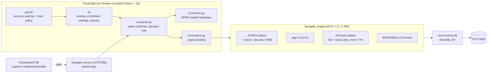

# FaceGate architecture

## Shape of the system

**Boundary.** Everything that is *compute* (pixels in, numbers out) is in the C++ engine. Everything that is *policy* (when to unlock, how many frames, lockout, which app) is Python. The boundary is one flat C ABI (`engine/include/facegate_engine.h`) of six functions, so the engine has no dependency on Python, Qt or OpenCV and can be reused from any host.

The Python `FaceEngine` (ONNX Runtime for Python) is kept for three jobs: the reference the C++ engine is tested against, the engine inside the Linux container, and the fallback when the DLL or its models are missing.

## Decisions

### 1. C++ engine over ONNX Runtime + DirectML, not CUDA or TensorRT
DirectML runs on any Windows GPU with no extra install. CUDA needs cuDNN and cuBLAS (about 1 GB) and TensorRT more; neither is practical to ship inside an exe. Measured, the engine already finishes a frame in about a quarter of the camera's frame interval, so a faster backend would not be felt.

### 2. Static shapes and FP16, prepared offline (`tools/prepare_models.py`)
| Change | Evidence (RTX 4050, DirectML) |
|---|---|
| Recognizer FP16, fixed batch 4 | 10.7 → 4.0 ms; embeddings stay at cosine ≥ 0.99995 of FP32 |
| Detector fixed at 384×640 | 16:9 frames no longer waste 40% on padding: 6.3 → 3.2 ms (with FP16) |
| Dynamic batch removed | DirectML rejects the recognizer's dynamic batch outright |
| Liveness stays FP32, moved to the GPU | 37 ms on the CPU with default threading → 1.4 ms |
FP16 was judged by the end-to-end LFW evaluation, not only by cosine: accuracy is unchanged (99.28% vs 99.26% clean).

### 3. Keep ResNet-50; do not adopt ResNet-100
`glintr100` (Glint360K, 261 MB) was evaluated on the same 7,081 photos, FP16 on the GPU. At FAR 1e-5 it is slightly better on masked probes (95.75% vs 94.38%); at the 1e-6 operating point, which is what matters for unlocking, it is worse (clean 99.39% vs 99.59%, masked 81.0% vs 88.8%) and costs twice the compute. LFW is saturated, so this is not a verdict on harder datasets - only that this benchmark gives no reason to pay for it.

### 4. Explicit GPU choice
The laptop has an Intel iGPU and the RTX 4050. DirectML's default happened to pick the NVIDIA part, but a graphics-settings change or a different boot can reorder adapters, and the iGPU is 10× slower. The engine requests the high-performance adapter and reports which one it got; `tools/bench_engine.py` shows NVIDIA utilisation while it runs.

### 5. ONNX Runtime's idle threads must not spin
Left at defaults, idle worker threads busy-wait on a 16-core hybrid CPU and steal time from the caller (an unrelated OpenCV call ran 4× slower). The engine disables spinning and gives GPU sessions a single CPU thread. Measure engines in separate processes - one engine's leftover thread pools slow the next.

### 6. Thresholds are calibrated, not guessed
`tools/eval_lfw.py` embeds every photo three ways (clean, synthetic mask, synthetic cap) through the real pipeline and searches thresholds for a stated false-accept budget: at 1 in 1,000,000 the whole-face threshold is 0.356. A second, "mask" view (lower face painted out, on both enrolled and probe side) is a second opinion for near-misses. A matching "cap" view was built and removed because it only added false accepts.

### 7. Two build products, because of privilege
Code that runs elevated (the SYSTEM lock-screen service, the elevated autostart task, "Restart as Administrator") must not load from a folder ordinary programs can write to, or those programs could swap it and gain administrator rights.

| Product | Unpacks to | Elevated features |
|---|---|---|
| Folder build, installed to Program Files | in place (admin-only folder) | yes |
| Single-file `FaceGate-portable.exe` | per-user cache | refused |

The compiled app enforces this (`elevation_safe()`), and elevated processes ignore the `FACEGATE_HOME` / `FACEGATE_NATIVE_DIR` overrides, because they would inherit them from the user's environment.

## Failure behaviour
- DLL, runtime or models missing → the Python engine is used (source installs), or the app reports it.
- GPU session cannot be created → that model falls back to the CPU.
- Hostile or malformed coordinates, undersized buffers and mismatched model outputs are rejected with an error code, never followed.
- Anything uncertain at the lock screen yields *no credential*; the password and PIN providers are untouched.

## Verification
| What | How |
|---|---|
| C++ engine equals the Python reference | `tests/test_native.py`: detection, alignment, both embedding views, liveness, template interchangeability, concurrency, hostile input |
| The two engines are interchangeable | a template enrolled by one engine is matched by the other (cosine > 0.98 for the same photo) |
| Accuracy | `tools/eval_lfw.py`: 17,118 same-person and 50,456,802 different-person comparisons |
| Speed | `tools/bench_engine.py`: each engine in its own process, per-stage split, GPU utilisation |
| Lock-screen component | `credential_provider/test/cp_test.cpp` plays LogonUI against a fake service |
